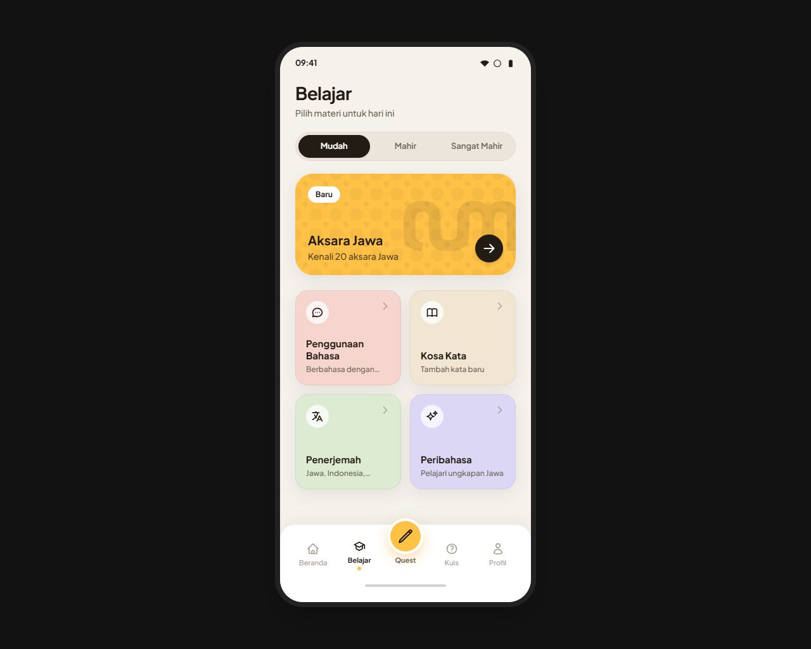
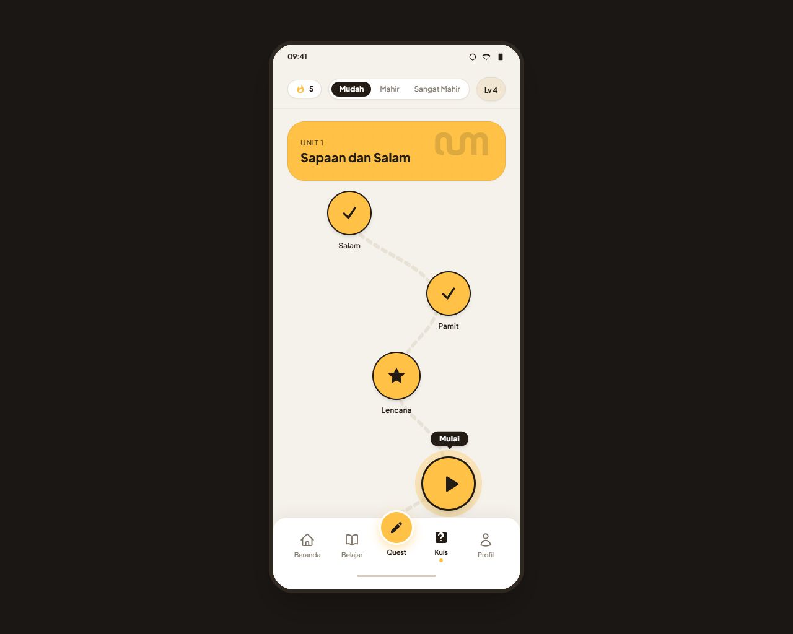
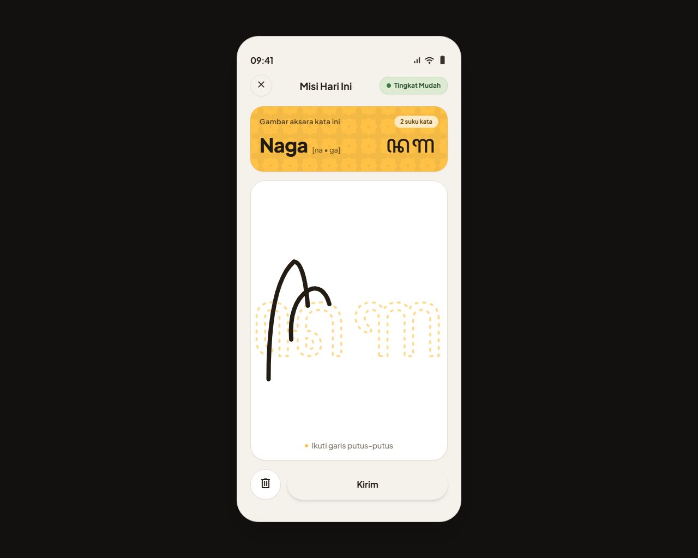
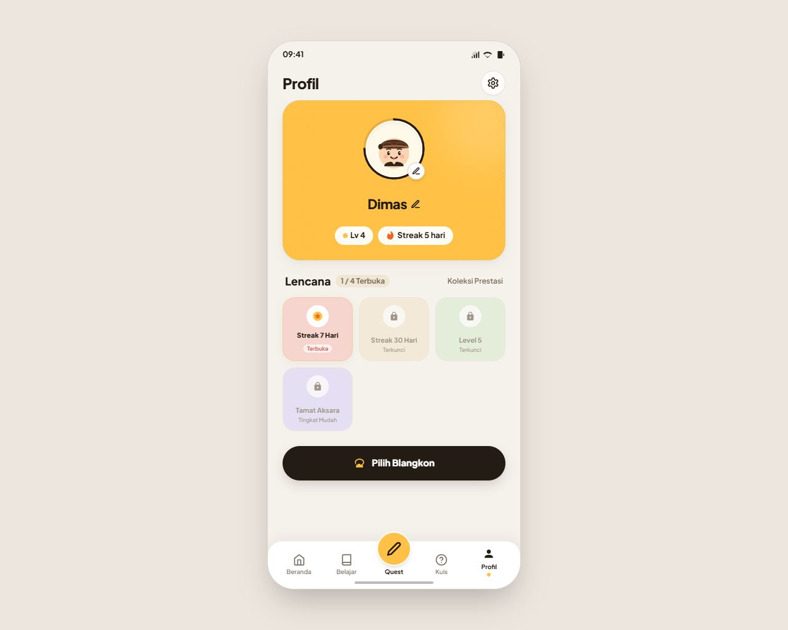

<!-- ISI placeholder sebelum dikumpulkan -->
# JawaLoka

Aplikasi pembelajaran bahasa dan aksara Jawa interaktif untuk perangkat Android, dikembangkan oleh **{{Scyter}}** dari **{{SMK Telkom Malang}}** untuk **{{Budaya Go}}**.

JawaLoka dirancang sebagai media edukasi budaya nusantara yang membantu pengguna mengenal tata krama bahasa Jawa (Ngoko, Krama Lugu, Krama Inggil) dan melatih penulisan aksara Jawa Carakan secara terstruktur melalui pendekatan gamifikasi berbasis level, hadiah blangkon, dan latihan harian.

Asal-usul proyek: {{ASAL_USUL}}

---

## Tangkapan Layar

| Beranda | Jalur Kuis |
| :---: | :---: |
|  |  |

| Kanvas Aksara | Profil & Blangkon |
| :---: | :---: |
|  |  |

> 💡 **Showcase & Sistem Desain Interaktif**: Buka berkas `docs/showcase.html` langsung di peramban (browser) untuk pengujian kanvas goresan interaktif, peta kurikulum 50 node, dan dokumentasi antropologi visual JawaLoka bagi dewan juri.

---

## Fitur yang Berfungsi

- **Jalur Kuis 50 Node**: 5 unit materi terstruktur dari perkenalan, aksara dasar, sandhangan, kosa kata, hingga unggah-ungguh basa dengan evaluasi di setiap akhir unit.
- **Tiga Bahasa Antarmuka**: Mendukung peralihan dinamis antarmuka bahasa Indonesia, Jawa, dan Inggris secara menyeluruh.
- **Sistem XP, Level, dan Hadiah Blangkon**: Akumulasi XP dari kuis dan quest menaikkan level pengguna (Level 1–10) serta membuka koleksi blangkon daerah secara otomatis.
- **Kanvas Quest Penulisan Aksara**: Kanvas interaktif yang menilai kemiripan goresan tangan terhadap aksara target tertentu dengan sistem skor akurasi.
- **Personalisasi Profil & Karakter Gender**: Pengaturan nama panggilan, umur, dan pilihan karakter adat Jawa (Putra dengan Surjan & Blangkon, Putri dengan Kebaya & Sanggul Cunduk Mentul) tanpa perlu registrasi akun atau kata sandi.
- **Penerjemah Contoh Frasa**: Fitur bantuan kosakata untuk menerjemahkan contoh frasa dasar sehari-hari secara offline.

---

## Batasan Aplikasi (Catatan Transparansi)

Aplikasi ini merupakan prototipe aplikasi untuk keperluan demo dan penjurian lomba, dengan batasan teknis sebagai berikut:

- **Data Profil Lokal Tanpa Backend**: Tidak memerlukan akun email atau kata sandi; data nama, umur, karakter gender, dan progres belajar tersimpan secara lokal dan aman di perangkat pengguna.
- **Penyimpanan Lokal**: Nama tampilan, preferensi bahasa, perolehan XP, level, dan progres kuis tersimpan secara lokal via SharedPreferences perangkat.
- **Perhitungan Hari**: Streak dan hari penyelesaian kuis mengandalkan jam lokal perangkat, bukan waktu server terverifikasi.
- **Draf Materi & Bahasa Jawa**: Soal kuis dan teks bahasa Jawa berstatus draf awal dan belum melalui validasi penutur jati/ahli bahasa Jawa.
- **Kanvas Quest Terbatas**: Evaluasi vektor goresan pada quest harian saat ini dibatasi pada huruf aksara berkurva tertentu (Ha, Na, Ca, Ra, Ka, Ja) untuk menjaga akurasi penilaian.
- **Penerjemah Terbatas**: Fitur penerjemah hanya mengenali kumpulan contoh frasa dasar tertentu dan bukan mesin penerjemah bahasa alami menyeluruh.

---

## Struktur Folder Proyek

- `lib/core`: Tema visual, routing, komponen bersama, dan mesin progresi XP/level.
- `lib/features`: Modul fitur aplikasi (beranda, kuis, quest kanvas, profil, materi belajar, dan penerjemah).
- `lib/data`: Model data dan sumber data lokal aplikasi.
- `lib/l10n`: Berkas lokalisasi ARB (Indonesia, Jawa, Inggris) dan konfigurasi generator bahasa.
- `test`: Rangkaian pengujian unit, widget, integrasi alur, paritas ARB, dan font rendering.
- `assets`: Aset visual dan berkas font ter-bundle (Noto Sans Javanese & Plus Jakarta Sans).
- `android`: Konfigurasi proyek native Android, applicationId, Gradle build script, dan aturan ProGuard.

---

## Cara Menjalankan

### Prasyarat
- Flutter SDK (versi ^3.10.7)
- Android SDK (API Level 34)

### Menjalankan Mode Pengembangan
```bash
cd flutter_jawaloka
flutter pub get
flutter run
```

### Membangun Paket Rilis (APK)
```bash
cd flutter_jawaloka
flutter build apk --release --split-per-abi
```
Berkas APK hasil build akan tersedia pada direktori `build/app/outputs/flutter-apk/`.

---

## Teknologi & Kredit Teknis

- **Framework & Bahasa**: Flutter dan Dart.
- **Lokalisasi**: Flutter Intl via ARB & `gen-l10n`.
- **Penyimpanan Lokal**: SharedPreferences.
- **Tipografi & Font**:
  - **Noto Sans Javanese**: Lisensi Open Font License (OFL).
  - **Plus Jakarta Sans**: Lisensi Open Font License (OFL).

